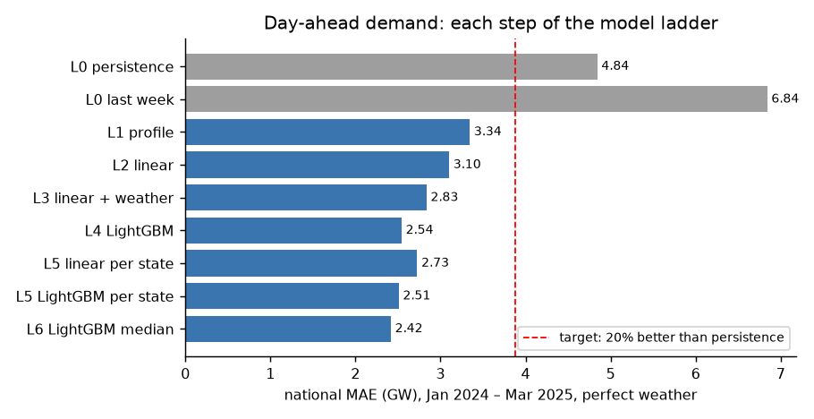
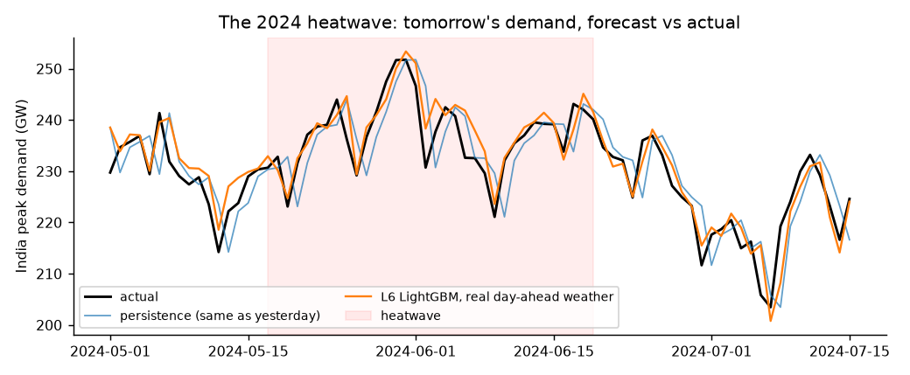
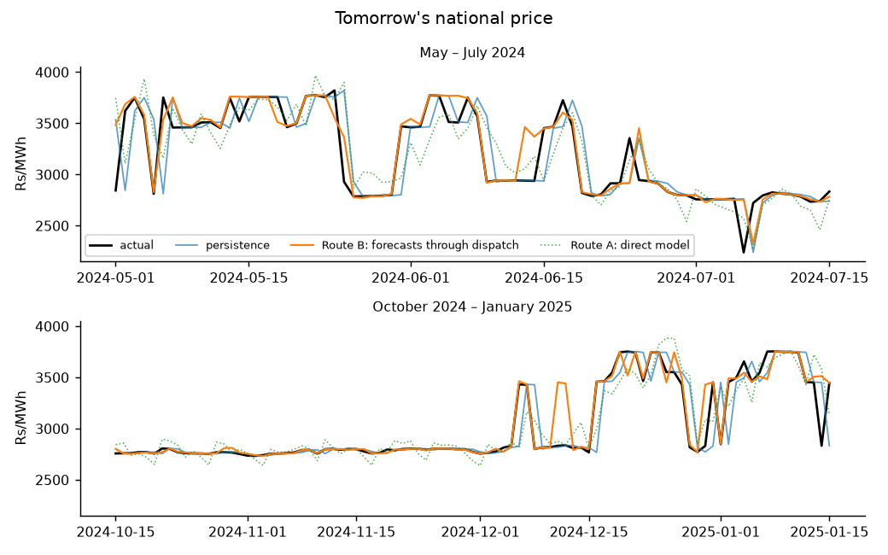
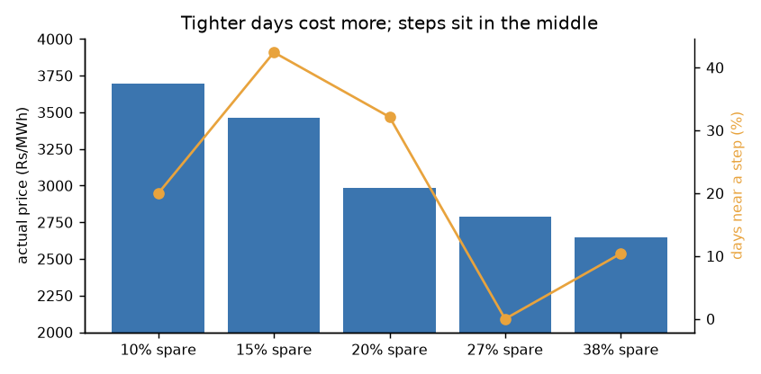
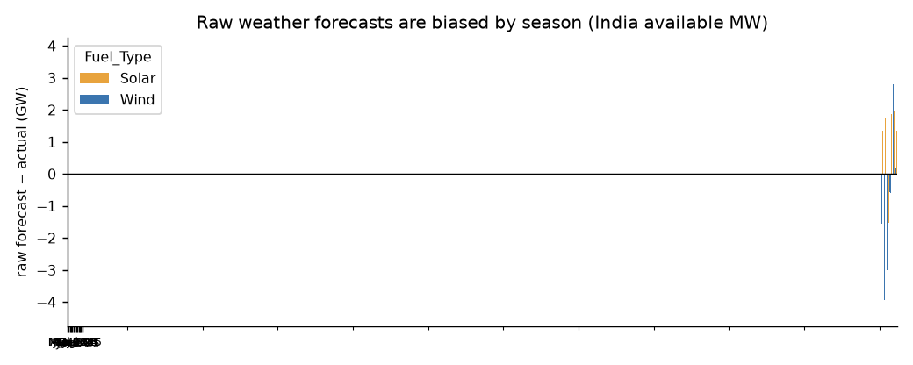
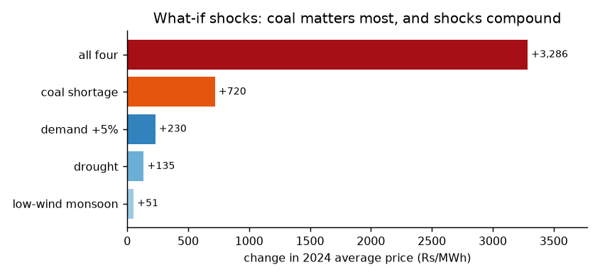

# Part 2 — Day-ahead forecasting of demand, supply and prices

*Strategic Grid Dispatch · Part 2 report · October 2026*

## Summary

On day D, can we forecast day D+1's peak demand, renewable supply and electricity prices for every Indian state better than "same as today"? **Yes, by a wide margin, once real weather forecasts are corrected for their bias and the price is forecast through the dispatch model.**

| Forecast for tomorrow | "Same as today" error | Best forecast error | Better by | How |
|---|---|---|---|---|
| India peak demand | 5,053 MW (2.3%) | 2,623 MW (1.2%) | **48%** | LightGBM on calendar, recent changes and anchored real weather forecasts |
| Solar availability | 1,375 MW | 921 MW | **33%** | average of physics-on-forecasts and LightGBM |
| Wind availability | 3,203 MW | 1,647 MW | **49%** | physics on anchored day-ahead wind forecasts |
| National price | 132 Rs/MWh | 63 Rs/MWh | **53%** | forecast demand and supply through the dispatch model |

The target set at the start (at least 20% better than "same as today") is met for every quantity. Forecasting the price directly from its own history does **not** work: a stepped price needs a model that knows where the steps are. All scores in this table are out-of-sample, from monthly walk-forward tests over the same 13 months (March 2024 – March 2025, when real weather forecasts exist), using only information available the day before. The demand model ladder in Section 4 uses the full test period (January 2024 – March 2025), where persistence is 4,842 MW.

---

## 1. Objective and link to Part 3

Indian power is traded a day ahead: the exchange clears tomorrow's market today. Part 2 asks what a market participant can know about tomorrow on the evening before:

- **O1** forecast every state's peak demand for tomorrow (target: 20% better than persistence)
- **O2** forecast tomorrow's solar, wind and hydro availability
- **O3** forecast tomorrow's prices through the Part 1 dispatch model, and compare with a direct price model
- **O4** measure the uncertainty and when forecasts fail
- **O5** hand Part 3 a forecast package: demand, supply, price, ranges and a tightness index

In Part 3, large generators bid strategically. Their view of tomorrow is Part 2's forecast; market power should bite on days forecast to be tight.

## 2. Data

| Data | Source | Notes |
|---|---|---|
| Daily peak demand, 32 states, 2020 – Mar 2025 | Grid-India daily reports (Part 1, cleaned) | 21 one-day typos fixed in Part 2 (e.g. Telangana 236 MW among ~12,400 MW days); 4 real cyclone days kept |
| Weather, 151 points | Open-Meteo historical archive | Points chosen by purpose: population-weighted cities for demand, solar parks, wind zones, dams |
| Hourly 100 m wind, 17 wind zones | Open-Meteo | The power curve must be applied hour by hour |
| **Real day-ahead weather forecasts**, all points | Open-Meteo previous-runs archive | Each hour as forecast the day before; complete from March 2024 |
| Holidays (152) and paddy-transplanting dates | Government holiday lists, state notices, newspapers | Every row sourced and reviewed |

## 3. Method

**Truth for supply and prices.** Solar, wind and hydro availability is computed from the weather with physical rules (radiation with panel heat loss, a turbine power curve on hourly wind, "leaky bucket" reservoirs with Himalayan snowmelt), each state scaled to its Part 1 average. The Part 1 dispatch model run with this daily availability gives the "actual" prices.

**Forecasts.** Every model predicts the *change* from today (log of tomorrow ÷ today), so "no change" is the baseline and models learn corrections. Models climb a ladder, one change per step: persistence → weekday × month profile → ridge regression → + weather → LightGBM → median LightGBM. Each is refit at the start of every test month on everything before it (walk-forward), and trained on actual weather while being fed weather *forecasts* in the test.

**Anchoring.** Raw weather forecasts are biased by season (Section 5). Instead of using them as they are, tomorrow = today's actual + (forecast for tomorrow − forecast for today); the bias, which persists from day to day, cancels.

**Prices.** Route B pushes tomorrow's forecast demand and availability through the dispatch model. Route A forecasts the price directly from its history, calendar and weather.

## 4. Results

### Demand (O1)

Every step helps. The weekly rhythm alone (L1) removes a third of the error: "same as yesterday" is wrong by ~10 GW every Monday. With real day-ahead weather the best model is 2,623 MW off nationally (**skill 0.48**); with perfect weather 0.50, with no weather forecast 0.43. The linear model's coefficients are readable: a holiday tomorrow −2.2%, the first paddy-transplanting day +3.8% (Punjab, Haryana), each extra cooling degree day +1.6%.

During the May–June 2024 heatwave, error falls from 4.8 GW (persistence) to 2.2 GW.

### Supply (O2)

Without a weather forecast, tomorrow's renewable output is barely more predictable than today's (LightGBM gains 7% for solar, 1% for wind). With anchored real forecasts: wind **0.49**, solar **0.33** (combined with LightGBM), hydro 0.28–0.32 (tens of MW). Even forecast well, wind's typical national error (1.6 GW) is two-thirds of demand's.

### Prices (O3)

| | National MAE | Skill | Jumps (≥ 200 Rs/MWh) caught | Calls that were right |
|---|---|---|---|---|
| Persistence | 132 Rs/MWh | 0 | 0 / 87 | — |
| **Route B (dispatch)** | **63** | **0.53** | **58 / 87** | **73%** |
| Route A (direct, best) | 127 | 0.04 | 0 / 87 | — |

Route B meets the target in every state (state skill 0.51–0.54). Demand error costs more than supply error (48 vs 38 Rs/MWh alone; 63 together). Persistence is always one day late on a jump; Route B mostly moves on the right day.

### Uncertainty and failure (O4)

- **Ranges:** dispatching the 10% and 90% demand forecasts gives price ranges that contain the actual on 93% of days. The state demand 10–90% range is slightly narrow (contains 75%)
- **Holidays** are the weakest point for demand (7.4 GW error vs 2.3 GW on normal days): all holidays are treated alike, but Holi and Diwali cut demand far more than Good Friday or Maha Shivratri
- **Step edges:** on 21% of days demand sits near a coal-tier step; there the price error is 3.6× larger (146 vs 41 Rs/MWh), though Route B still beats persistence

## 5. What failed, and what it taught

1. **Raw weather forecasts made solar *worse* than persistence** (skill −0.58), and demand forecasts with them no better than without. The forecast model is too sunny in the hazy dry months (+3.8 GW of solar in May) and too cloudy in the monsoon (−4.3 GW in August). Mixing forecast tomorrow with measured today turned that bias into fake changes. **Anchoring** fixed it.

   

2. **The direct price model failed** (Route A). Price history cannot tell where the next coal-tier step is, so the median model learns "no change" and the mean model calls jumps at random. For a stepped price the structural model is necessary.
3. **Data typos** surfaced only when building forecast features (×50 daily ratios); they were also distorting Part 1's prices on those days. Fixing them at source changed ~22 days per run.

## 6. What-ifs: how fragile are prices?

Over 2024: 5% more demand raises prices 7.5% (the supply curve is steep at the top). A coal shortage (availability 0.75 → 0.65) is the largest single shock (+23%, shortages on 17 days, worst in January). All four shocks together double the price and cause shortages on 156 days: pressures compound near the top of the supply curve. The north (J&K, Punjab, Haryana) is hit hardest.

## 7. Hand-off to Part 3 (O5)

`data/processed/part3_forecast_package.csv` (load with `load_forecast_package()` in `src/forecast.py`): for every day and area, what was forecast the day before — demand with a 10–90% range, available MW by fuel, price with a range, tightness, and a near-step flag — next to what happened. On the 44 days forecast to have less than 10% spare capacity, the forecast price averaged Rs 3,754/MWh against 3,736 actual.

**For Part 3:** today about 4% of days are tight (< 10% spare); one year of demand growth would make it 25%, a coal shortage 45%. Tight days and step-edge days are where withholding a little capacity moves the price most.

## 8. Limitations and extensions

- **The "actual" price is our model's**, not a market price: Route B uses the exact price mechanism, which flatters it. `src/prices.py` is ready to compare with real IEX Day-Ahead Market prices by bid area once downloaded (`data/raw/iex_bid_areas.csv`; four mappings flagged uncertain)
- **Availability "truth" is modelled** from weather, not measured generation; CEA generation data could calibrate it
- **13 scored months** for the realistic case; anchoring was chosen after seeing the first run (raw results are kept)
- **Daily peak only**; no time of day, ramping, reserves or demand response
- **Extensions not done:** 7- and 30-day horizons; how much training history is needed; a major/minor holiday feature; re-tuning LightGBM for prices

---

*Reproduce: notebooks 05–12 in order (`notebooks/`), figures with `.venv/bin/python reports/make_part2_figures.py`. Every step is recorded in `docs/model_log.md` (Steps 11–20); data sources in `data/README.md`.*
