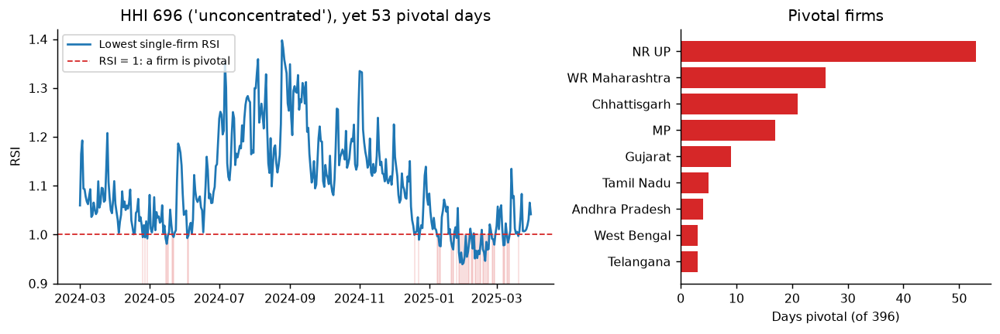
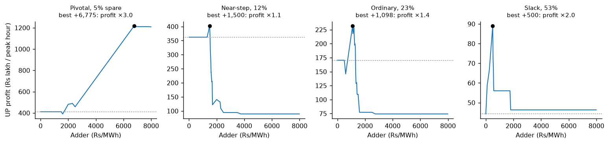
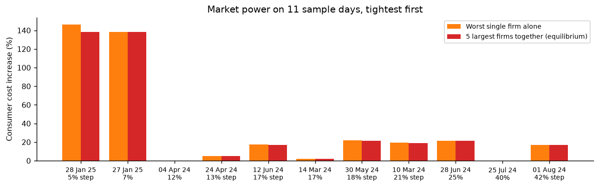
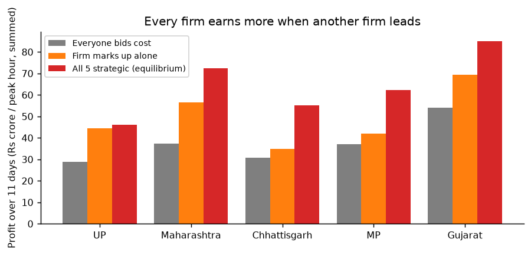
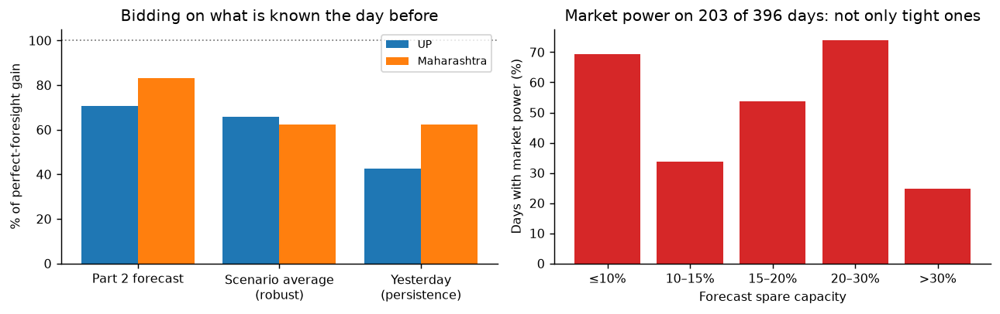
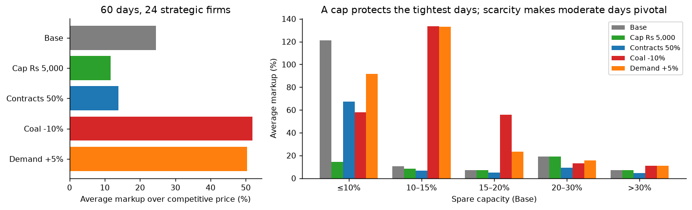

# Part 3 — Strategic bidding and market power

*Strategic Grid Dispatch · Part 3 report · October 2026*

## Summary

What happens to India's electricity prices when large generators bid above their true cost instead of at cost? **Consumers pay much more, on far more days than the usual screening test suggests, and competition between large firms does little to stop it.**

| Question | Answer |
|---|---|
| **When?** | On the tightest days (5–11% spare capacity), a pivotal firm can push prices close to the cap: consumers pay **+138% to +147%**. But market power isn't limited to tight days: on moderate and even slack days a large firm can raise the price to just under the next coal-cost step, **+17% to +22%** |
| **Who?** | The big central and western coal states: UP (pivotal on 53 of 396 days), Maharashtra (26), Chhattisgarh (21), MP (17), Gujarat (9) |
| **How much?** | Up to **Rs ~122 crore per peak hour** on the tightest days; Rs 9–15 crore per peak hour on moderate and slack days with a +17–22% markup |
| **Does competition limit it?** | **No.** With the five largest firms all bidding strategically, prices end up about where the worst single firm alone would put them. One firm raises its bid; the others keep bidding cost and sell everything at the higher price (a *price umbrella*) |
| **What limits it?** | **A lower price cap.** With all 24 large firms bidding strategically, a Rs 5,000 cap halves the average markup (24.5% → 11.6%) and cuts the highest from 140% to 23%. A 10% coal shortage or 5% more demand roughly **doubles** the markup. The effect of 50% long-term contracts is uncertain |
| **Can firms see it coming?** | **Mostly.** Bidding on Part 2's day-ahead forecasts, UP and Maharashtra keep 71–83% of the profit they would make with perfect foresight, and consumers pay about as much. But simple warning flags (forecast spare capacity < 15%, near a coal-cost step) catch under half of the market-power days |
| **Does the usual test catch it?** | **Only partly.** Market concentration (HHI 696) looks harmless. The Residual Supply Index finds the 53 tight days, but misses market power on ordinary days, which comes from the **steps** in the supply curve, not from scarcity |

All results come from the Part 1 dispatch model (state-level, with transmission losses and locational prices) run on Part 2's weather-based supply for March 2024 – March 2025 (396 days). "UP", "Maharashtra" etc. are firms that own **all** of their state's coal, lignite, gas and hydro, so the numbers are an **upper bound** on real market power.

---

## 1. Objective and link to Parts 1–2

The README's second research question: *what happens to prices and dispatch outcomes when large generators bid strategically instead of at true marginal cost — where does market power show up, and how much does it cost consumers?*

Parts 1 and 2 assume every plant bids its true cost (a competitive market). Part 3 relaxes that.

- **Part 1 supplies the market:** the dispatch model (linear program with transmission losses), the generator stack and coal cost tiers
- **Part 2 supplies the days:** weather-based availability of solar, wind and hydro for each state and day, and the competitive "actual" prices used as the benchmark

## 2. Set-up

| Element | Choice |
|---|---|
| **Firms** | One firm per state: it owns that state's generator blocks (30 firms have strategic plant; 24 have at least 1 GW) |
| **Roles** | *Strategic* (coal, lignite, gas, hydro): bid cost + adder, may withhold. *Must-run* (solar, wind): bid 0, never withheld, paid the clearing price. *Cost* (nuclear, biopower, diesel): bid true cost |
| **Bid** | Cost + adder + Rs 1 (the Rs 1 keeps bids off exact ties with other blocks' round-number costs) |
| **Price cap** | Rs 10,000/MWh (also the value of lost load). Highest bid **Rs 8,990**, so power delivered over the longest route (10% loss) still costs less than the cap |
| **Payment** | Every plant is paid its home state's clearing price (pay-as-clear). Profit = (price − **true** cost) × MW, never price − bid |
| **Days** | 1 Mar 2024 – 31 Mar 2025 (396), Part 2's scored period |

## 3. Method

A ladder, one change at a time:

| Level | Method |
|---|---|
| **M0** | Competitive benchmark: everyone bids cost (Part 2's `dispatch_weather_*` run) |
| **M1** | Market structure without optimisation: capacity shares, HHI, Residual Supply Index (RSI), pivotal tests |
| **M2** | One strategic firm: try ~55 bid levels × withholding shares, re-run the market for each, keep the most profitable |
| **M3** | Several strategic firms: each in turn picks its best bid given the others' (best-response iteration) until nobody wants to change — a Nash equilibrium |

**Searching for the best bid.** A price-setting firm's profit rises with its bid until the bid passes a rival's, so the best bid usually sits just below some rival. The search tries Rs 1 below every rival's bid level, the cap, and a regular grid every Rs 250 (because losses shift the peaks between round levels), then refines every Rs 25 around the best.

**Checks.** Every tool was proved on hand-solved cases before use: a pivotal toy firm bids the cap (profit 399,500 as calculated by hand); a non-pivotal one bids just below its rival (139,930); bidding true cost reproduces Part 2's prices exactly (difference 0.0 on three real days); a bid at the cap never causes an artificial blackout; a two-firm equilibrium matches its hand solution. 111 automated tests in total.

## 4. Results

### 4.1 Market structure: concentration isn't market power (M1)



- **HHI 696** on average: "unconcentrated" by the usual competition-authority bands (below 1,500). The largest firm, UP, holds only 12% of strategic capacity
- Yet on **53 of 396 days (13%) a firm is pivotal**: India can't meet demand without it. UP is pivotal on all 53
- **Two or more firms are pivotal at once** on 26 of those days (up to 9)
- **Pivotal days are winter days, not summer:** 35 of the 53 fall in January–February 2025, when wind and hydro are low and demand has grown; summer 2024 has 10
- Pivotal days all have **5–11% spare capacity**; every day under ~10% spare has a pivotal firm

**Lesson:** a market can look competitive by concentration and still give single firms decisive power on tight days.

### 4.2 One strategic firm on one day (M2)

UP bids strategically; everyone else bids cost.



| Day | Spare | UP's best coal bid | UP profit | Consumers pay |
|---|---|---|---|---|
| Pivotal (30 Jan 2025) | 5% | Rs 8,976 (near the cap) | ×3.0 | **+139%** (+Rs 124 crore/h) |
| Near a coal-tier step (6 Feb 2025) | 12% | Rs 3,701 (one tier up) | ×1.1 | +5% |
| Ordinary (17 Mar 2024) | 23% | Rs 3,299 | ×1.4 | **+21%** |
| Slack (25 Aug 2024) | 53% | Rs 2,701 (just under the next tier) | ×2.0 | **+21%** |

- **Market power without scarcity.** Even on the slackest day of the year UP doubles its profit. The 53% spare capacity is mostly *expensive* plant; the cheaper rivals are already running flat out, so UP still sets the price when it bids up to just under the next coal tier. **Spare capacity is not the same as cheap spare capacity**, and the RSI can't see the difference
- **Consumers lose far more than the firm gains:** on the slack day UP gains Rs 0.45 crore/h, consumers pay Rs 9.6 crore/h more, because every plant that runs is paid the higher price
- **Raising the bid always beats withholding**, and combining the two never helped
- **Little fuel is wasted:** true generation cost rises only 0.2–3.8%. The harm is in prices, not efficiency

### 4.3 Five strategic firms together (M3, sample study)

The five largest firms (UP, Maharashtra, Chhattisgarh, MP, Gujarat; 45% of strategic capacity) on **11 days** chosen across the range of conditions: two per tightness band, one near a coal-tier step and one not, plus the national peak day.



- **Alone, each big firm marks up on 45–82% of the days**, slack days included
- **Together, prices end up about where the worst single firm alone puts them**: within Rs 0–310/MWh, usually under Rs 25. Consumers pay **+138%** on the two tightest days (~Rs 122 crore/h), **+17% to +22%** on five moderate and slack days, 0–5% on the rest
- **Every equilibrium settles** (1–2 rounds); no undercutting cycles, no ties



**Why rivals don't compete the price down: the price umbrella.** On 9 of 11 days only **one** firm raises its bid. Once it has, the other big firms do better by bidding cost: they sell all their output at the leader's higher price. Undercutting the leader would mean selling a little more at a lower price, which pays less. Every firm earns more when another leads than when it marks up alone.

**Who leads isn't determined, but the price nearly is.** Changing the order in which firms move (Gujarat first instead of UP) changes the leader on 8 of 11 days, but prices by at most Rs 200/MWh. So *how much consumers pay* is a robust result; *which firm* exercises the power is not.

### 4.4 Bidding on forecasts (Stage 6, all 396 days)

A firm must choose tomorrow's bid today. UP and Maharashtra (each alone, everyone else at cost) choose their bid with five rules, then the market clears on the **actual** day:

| Rule | The firm picks the best bid for… |
|---|---|
| Perfect foresight | the actual day (upper bound) |
| **Part 2 forecast** | Part 2's median forecast of demand, solar, wind and hydro |
| Scenario average ("robust") | the average over the low, median and high demand forecasts |
| Yesterday (persistence) | yesterday's actual day |
| Cost | no markup |



| | UP | Maharashtra |
|---|---|---|
| Days marking up pays (perfect foresight) | 162 | 295 |
| Share of the perfect-foresight gain: forecast / scenario average / yesterday | **71%** / 66% / 43% | **83%** / 62% / 62% |
| Days the forecast bid earns less than bidding cost | 39 | 22 |
| Days the scenario-average bid earns less than bidding cost | 43 | 83 |

- **Forecasts are worth money to a strategic firm:** they keep most of the gain and beat "tomorrow = today" by 20–28 points
- **Averaging over scenarios is the riskiest rule, not the safest.** In the high-demand scenario a high bid pays enormously (near the cap), so the average favours high bids, and on an ordinary day the firm prices itself out
- **Forecast errors don't protect consumers:** consumer cost rises about as much with forecast bids as with perfect foresight (UP +17.6% vs +16.9%)
- **Warning flags catch market power only partly.** On 203 of 396 days UP or Maharashtra can raise the average price by ≥ 5%. Forecast spare capacity < 15% or a near-step flag catches 43% of those days, with half of the flagged days right. Flags computed from the *actual* day do little better (48%), so the weakness is the flags, not the forecasts: market power is most common at **20–30% spare capacity** (74% of days), where a firm can price up to the next coal-cost step

### 4.5 What-ifs: price cap, contracts and stress (Stage 7)

All **24 firms** with at least 1 GW of strategic plant play the equilibrium on **60 days** spread evenly over spare capacity, under five settings. Each setting's competitive benchmark is re-run under the same change.



| What-if | Average markup (all 60 days) | Average markup (21 settled days) | Highest markup | Extra consumer cost (Rs crore/h) |
|---|---|---|---|---|
| Base | 24.5% | 29.9% | 140% | 19.1 |
| **Price cap Rs 5,000** | **11.6%** | **12.6%** | **23%** | 7.8 |
| 50% sold under contract | 13.9% | 26.4% | 137% | 10.9 |
| Coal −10% | 51.9% | 41.9% | 141% | 44.3 |
| Demand +5% | 50.4% | 37.2% | 141% | 44.3 |

- **A lower cap is the most effective limit:** it halves the average markup, and on the tightest days (≤ 10% spare) cuts it from 121% to 15%
- **Scarcity multiplies market power:** a coal shortage raises the competitive price 18% but the equilibrium price 43% (demand +5%: 13% vs 35%). Days with 10–15% spare become pivotal, and their markup jumps from 10% to 133%
- **Contracts: not a robust result.** Over all days they halve the markup; over days that settle, only 30% → 26%. On the tightest days a firm with half its output contracted still marks up (121% → 68%)
- **With 24 firms, a third of the days don't settle** within 5 rounds (16 hit the limit, 3 cycle in Base). Settled days show the same price umbrella as the 5-firm sample (exactly one firm marks up); on unsettled days 3–6 firms are still adjusting. Markups by spare capacity match the 5-firm sample within ~17 points

## 5. What surprised us

Hypotheses were written down before each run.

| Hypothesis | Result |
|---|---|
| Concentration is low, yet firms are pivotal | ✅ HHI 696, 53 pivotal days |
| Pivotal days cluster in the summer peak | ❌ Winter (Jan–Feb 2025): low wind and hydro |
| Market power needs tight days near a coal-tier step | ❌ Tight days, yes, but mostly *not* near a step (the price is already high); and market power also appears on ordinary and slack days |
| A pivotal firm bids at the cap | ✅ |
| On a slack day, bidding cost is best | ❌ UP doubles its profit |
| Several strategic firms push prices higher than one | ❌ About the same: one leads, the rest free-ride |
| Some equilibria cycle | ❌ All converge |
| Forecast bids keep > 80% of the perfect-foresight gain | ✅ Maharashtra 83%, ❌ UP 71% |
| A scenario-average bid is safer | ❌ It loses most often |
| Forecast tightness flags market-power days | Only partly: 43% caught; market power peaks at 20–30% spare |
| A lower price cap bites only on the tightest days | ❌ It halves the average markup |
| Contracts roughly halve markups | ⚠️ Over all days yes, over settled days no |
| Stress raises market power more than costs | ✅ Equilibrium price up ~2.5× as much as the competitive price |

Two mistakes were caught by testing on the real grid, not on toy cases:
- A first price-cap rule (highest bid Rs 9,990) caused **14,390 MW of artificial blackout** when UP bid the cap: transmission losses pushed the delivered price above the cap, so distant states "preferred" a blackout. Fixed by lowering the highest bid to Rs 8,990
- A first version of the hand example for a non-pivotal firm was wrong (the firm couldn't cover demand alone, so its rival set the price whatever it bid). Corrected before use

## 6. Limitations

- **One firm per state.** Real ownership within a state is split between NTPC, state utilities and private companies, so these markups are an **upper bound**
- **Stepped costs.** Each state × fuel block has one cost; real plants have a spread of costs, which would smooth the steps that drive much of the market power found here
- **Samples, not the full year,** for the equilibrium: 11 days with 5 firms (the other 19 large firms bid cost), and 60 days with all 24 for the what-ifs, where a third of the days don't settle within 5 rounds
- **Stage 6 uses two firms, each alone,** to define market-power days; days where only a smaller firm has power are missed
- **No transmission limits** (losses only), so the market is national. Congestion could split it into regions where single firms are stronger (UP holds 46% of the North's strategic capacity)
- **Long-term contracts only as a what-if.** In India most generation is sold under long-term power purchase agreements; the 50% contract what-if gives a result that depends on the days that don't settle
- **Bid only** in the equilibrium (withholding never helped in the one-firm search); a one-day game (hydro can't save water between days); daily peak only, no hourly bidding

## 7. Deferred work

Built and tested but not yet run (`src/run_part3.py`; notebook `15_market_power_all_days`; `docs/part3_plan.md`):

| Stage | What | Estimated runtime (9 processes) |
|---|---|---|
| 4 | Each of the 24 large firms alone, all 396 days | ~16 min |
| 5 | Equilibrium of all 24 firms, all 396 days | ~50–60 min (Stage 7 took 36 min for 300 such days) |

## Reproducing

```bash
.venv/bin/python -m pytest
.venv/bin/python reports/make_part3_figures.py
```

Notebooks `13_market_structure` (structure, bidding tools), `14_strategic_bidding` (one firm), `15_market_power_sample` (alone vs together), `16_bidding_with_forecasts` (Stage 6; `src/run_part3.py stage6`, 6.3 min), `17_what_ifs` (Stage 7; `stage7`, 36 min). Every step, decision and check is in `docs/model_log.md`, Steps 21–28.
